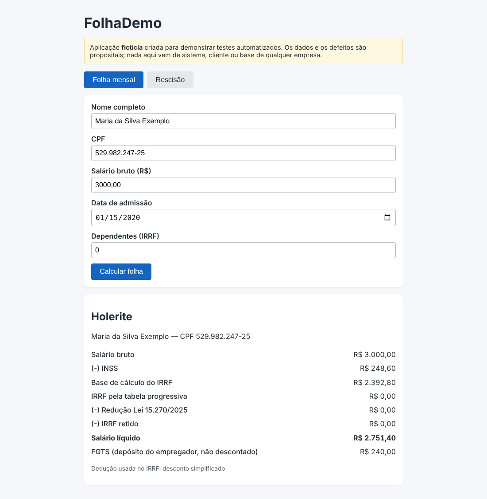
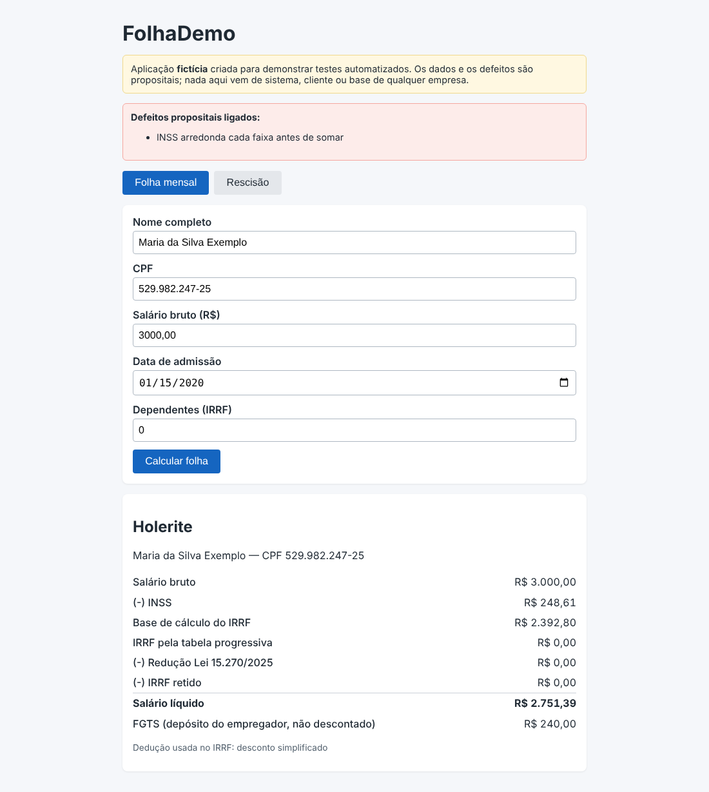

# DEF-03: INSS arredonda cada faixa antes de somar e gera 1 centavo de diferença

| Campo | Valor |
|---|---|
| Módulo | Folha mensal |
| Regra de negócio | RN-ARR-01 (`docs/regras-de-negocio.md`) |
| Identificador técnico | `arredondamento_antecipado` |
| Severidade | **Média**: A diferença por pessoa é de 1 centavo. |
| Prioridade | **Média**: O erro se acumula na guia e na conciliação de muitos funcionários; precisa de decisão do negócio sobre a regra de arredondamento. |
| Origem | Defeito **plantado de propósito** para demonstração (sistema fictício) |
| Ambiente | FolhaDemo local (build de preview), Chrome, fuso America/Sao_Paulo |
| Status | **Fechado (simulado)**: detectado pela suíte; correção = desligar o defeito |

## Como ligar o defeito

Na URL: `/?defeitos=arredondamento_antecipado` ou, nos scripts, `DEFEITOS=arredondamento_antecipado`.

## Passos para reproduzir

1. Abrir a aplicação com o defeito ligado.
2. Preencher o cadastro com os dados abaixo.
3. Clicar em **Calcular folha**.
4. Conferir os valores do holerite.

**Dados usados (todos fictícios)**

- Nome: Maria da Silva Exemplo (fictício)
- CPF: 529.982.247-25 (fictício)
- Admissão: 15/01/2020
- Salário bruto: R$ 3.000,00
- Dependentes: 0

## Resultado esperado x obtido

O esperado vem da calculadora independente (não da tela). A tabela mostra todos os itens do holerite.

| Item | Esperado | Obtido com o defeito |
|---|---|---|
| INSS | R$ 248,60 | R$ 248,61 |
| Base do IRRF | R$ 2.392,80 | R$ 2.392,80 |
| IRRF pela tabela | R$ 0,00 | R$ 0,00 |
| Redutor | R$ 0,00 | R$ 0,00 |
| IRRF retido | R$ 0,00 | R$ 0,00 |
| FGTS (empregador) | R$ 240,00 | R$ 240,00 |
| Líquido | R$ 2.751,40 | R$ 2.751,39 |

## Impacto

Diferença de centavos que se acumula na folha e na guia.

## Evidência

Sem o defeito (comportamento correto):

Com o defeito ligado:

## Como a suíte detecta

Executando a suíte com `DEFEITOS=arredondamento_antecipado`, ao menos um teste falha (ver `docs/qualidade/deteccao.md`). Sem o defeito, todos passam.

## Ciclo de vida

Novo → Em análise → Em correção → Corrigido → Reteste (com regressão em volta) → **Fechado**. Por ser defeito simulado, "corrigir" é desligá-lo; o reteste é a suíte completa passar sem ele.
