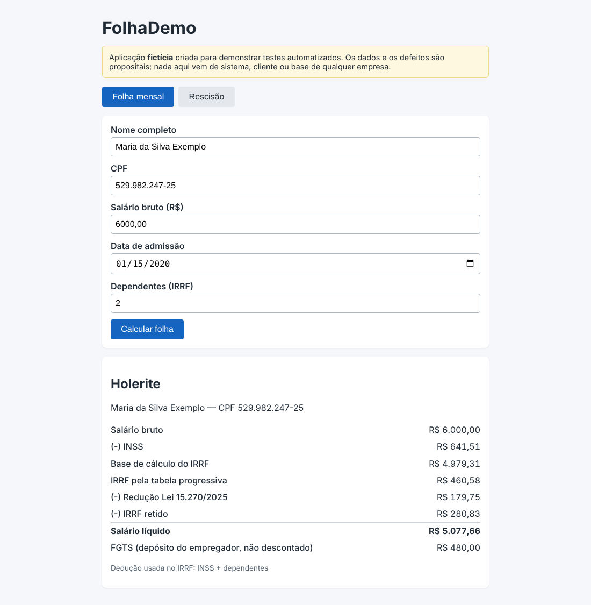
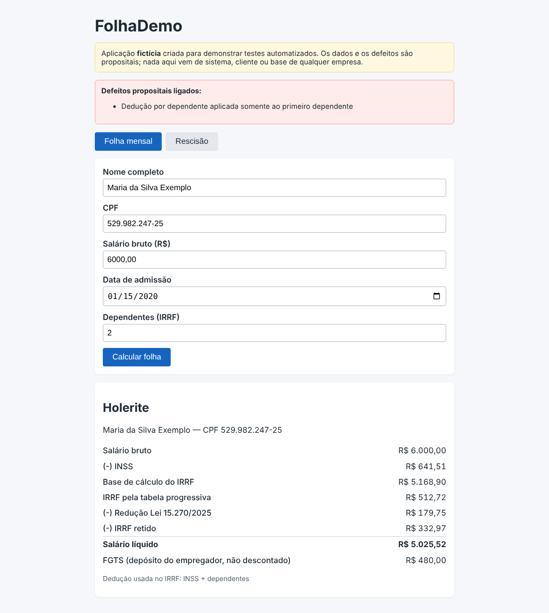

# DEF-05: Dedução por dependente aplicada apenas ao primeiro dependente

| Campo | Valor |
|---|---|
| Módulo | Folha mensal |
| Regra de negócio | RN-IRRF-01 (`docs/regras-de-negocio.md`) |
| Identificador técnico | `irrf_dependente_so_primeiro` |
| Severidade | **Alta**: IRRF maior que o devido para quem tem 2 ou mais dependentes. |
| Prioridade | **Alta**: Atinge famílias e é fácil de ser percebida pelo funcionário. |
| Origem | Defeito **plantado de propósito** para demonstração (sistema fictício) |
| Ambiente | FolhaDemo local (build de preview), Chrome, fuso America/Sao_Paulo |
| Status | **Fechado (simulado)**: detectado pela suíte; correção = desligar o defeito |

## Como ligar o defeito

Na URL: `/?defeitos=irrf_dependente_so_primeiro` ou, nos scripts, `DEFEITOS=irrf_dependente_so_primeiro`.

## Passos para reproduzir

1. Abrir a aplicação com o defeito ligado.
2. Preencher o cadastro com os dados abaixo.
3. Clicar em **Calcular folha**.
4. Conferir os valores do holerite.

**Dados usados (todos fictícios)**

- Nome: Maria da Silva Exemplo (fictício)
- CPF: 529.982.247-25 (fictício)
- Admissão: 15/01/2020
- Salário bruto: R$ 6.000,00
- Dependentes: 2

## Resultado esperado x obtido

O esperado vem da calculadora independente (não da tela). A tabela mostra todos os itens do holerite.

| Item | Esperado | Obtido com o defeito |
|---|---|---|
| INSS | R$ 641,51 | R$ 641,51 |
| Base do IRRF | R$ 4.979,31 | R$ 5.168,90 |
| IRRF pela tabela | R$ 460,58 | R$ 512,72 |
| Redutor | R$ 179,75 | R$ 179,75 |
| IRRF retido | R$ 280,83 | R$ 332,97 |
| FGTS (empregador) | R$ 480,00 | R$ 480,00 |
| Líquido | R$ 5.077,66 | R$ 5.025,52 |

## Impacto

Imposto errado para quem tem 2 ou mais dependentes.

## Evidência

Sem o defeito (comportamento correto):

Com o defeito ligado:

## Como a suíte detecta

Executando a suíte com `DEFEITOS=irrf_dependente_so_primeiro`, ao menos um teste falha (ver `docs/qualidade/deteccao.md`). Sem o defeito, todos passam.

## Ciclo de vida

Novo → Em análise → Em correção → Corrigido → Reteste (com regressão em volta) → **Fechado**. Por ser defeito simulado, "corrigir" é desligá-lo; o reteste é a suíte completa passar sem ele.
