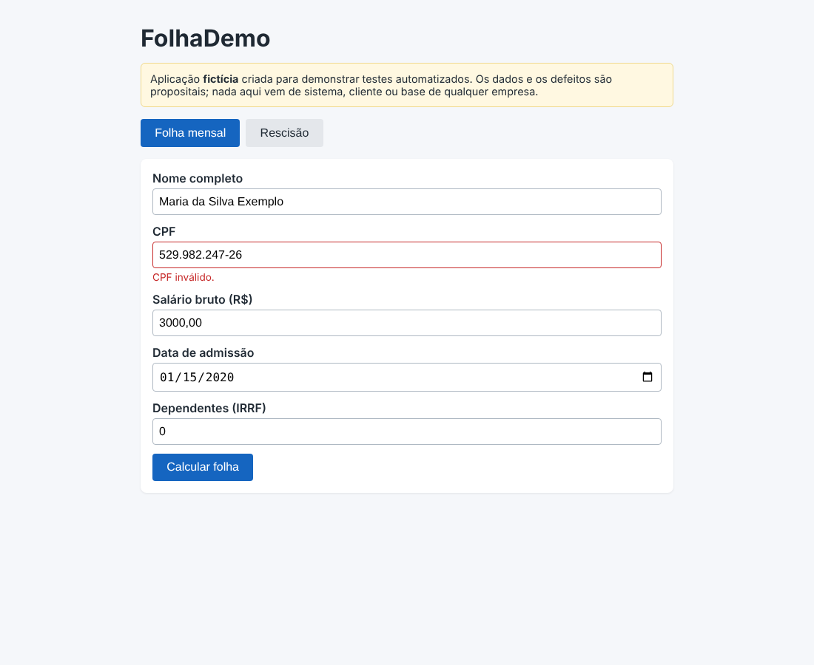
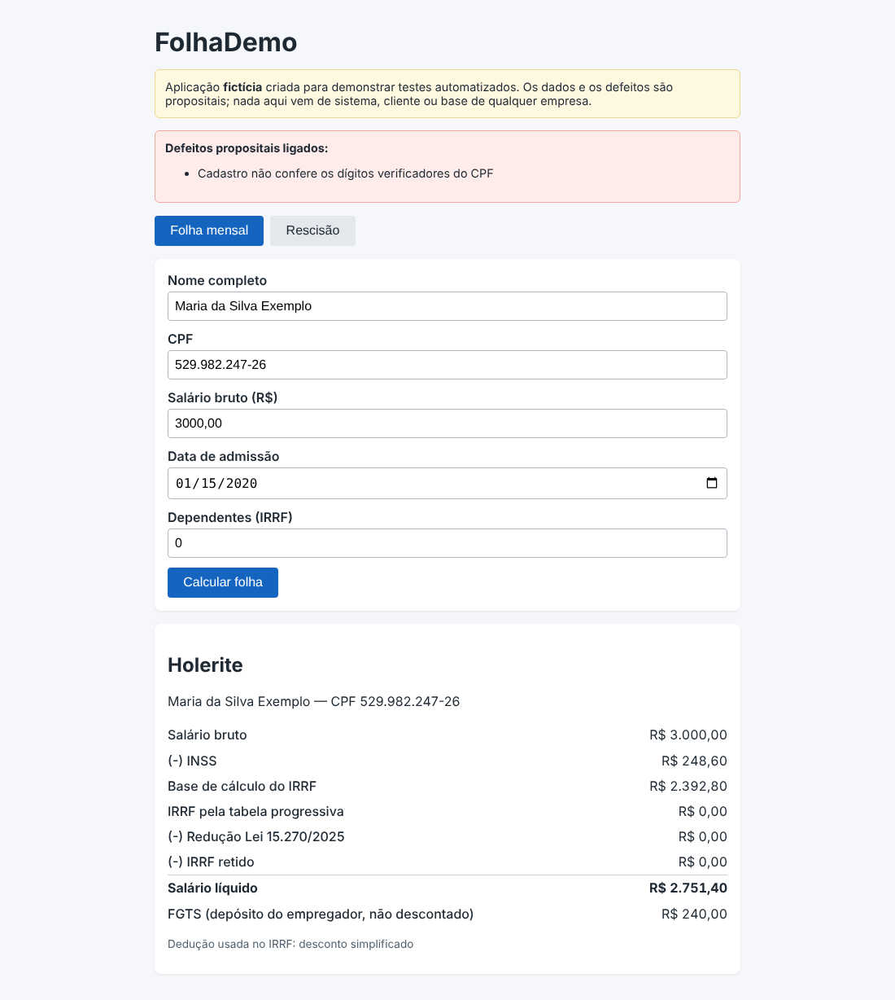

# DEF-08: Cadastro não confere os dígitos verificadores do CPF

| Campo | Valor |
|---|---|
| Módulo | Cadastro |
| Regra de negócio | RN-CAD-02 (`docs/regras-de-negocio.md`) |
| Identificador técnico | `cpf_sem_digito_verificador` |
| Severidade | **Média**: Funcionário fica cadastrado com documento inválido. |
| Prioridade | **Média**: Gera rejeição em obrigações acessórias (eSocial) e retrabalho no cadastro. |
| Origem | Defeito **plantado de propósito** para demonstração (sistema fictício) |
| Ambiente | FolhaDemo local (build de preview), Chrome, fuso America/Sao_Paulo |
| Status | **Fechado (simulado)**: detectado pela suíte; correção = desligar o defeito |

## Como ligar o defeito

Na URL: `/?defeitos=cpf_sem_digito_verificador` ou, nos scripts, `DEFEITOS=cpf_sem_digito_verificador`.

## Passos para reproduzir

1. Abrir a aplicação com o defeito ligado.
2. Preencher o cadastro com o valor inválido de **CPF** e os demais campos válidos.
3. Clicar em **Calcular folha**.
4. Observar se o cadastro foi recusado.

**Dados usados (todos fictícios)**

- CPF: 529.982.247-26
- Demais campos: dados fictícios válidos

## Resultado esperado x obtido

O esperado vem da calculadora independente (não da tela). 

| Item | Esperado | Obtido com o defeito |
|---|---|---|
| Resultado do cadastro inválido | Recusado com mensagem de erro (1 aviso) | Aceito: holerite gerado |

## Impacto

Funcionário cadastrado com documento inválido.

## Evidência

Sem o defeito (comportamento correto):

Com o defeito ligado:

## Como a suíte detecta

Executando a suíte com `DEFEITOS=cpf_sem_digito_verificador`, ao menos um teste falha (ver `docs/qualidade/deteccao.md`). Sem o defeito, todos passam.

## Ciclo de vida

Novo → Em análise → Em correção → Corrigido → Reteste (com regressão em volta) → **Fechado**. Por ser defeito simulado, "corrigir" é desligá-lo; o reteste é a suíte completa passar sem ele.
