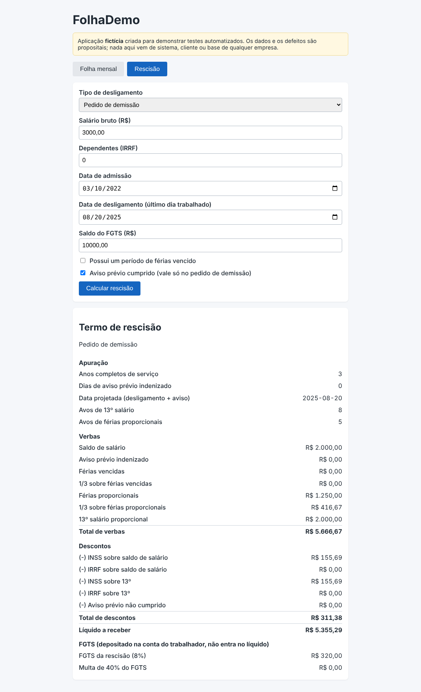
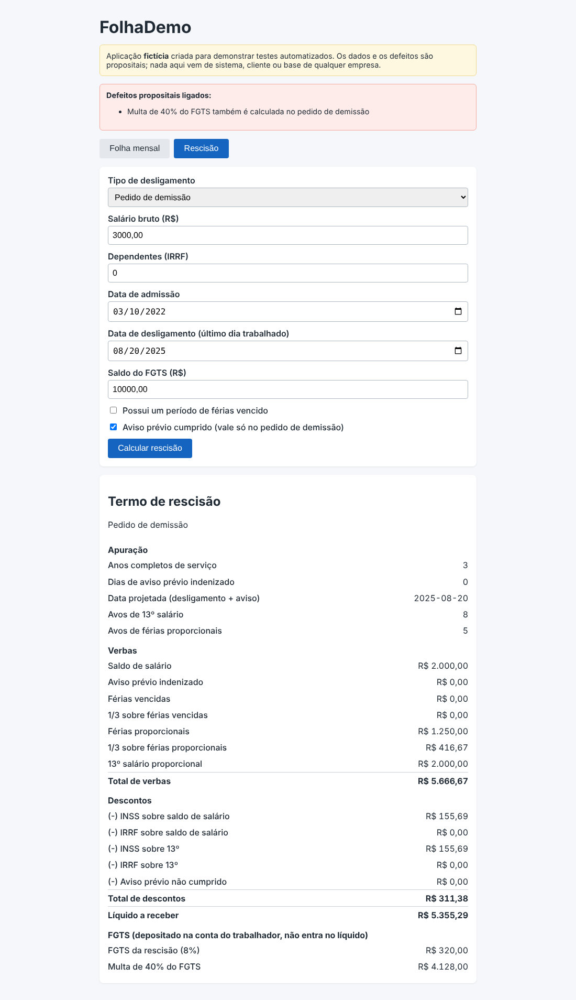

# DEF-09: Multa de 40% do FGTS calculada no pedido de demissão

| Campo | Valor |
|---|---|
| Módulo | Rescisão |
| Regra de negócio | RN-RES-09 (`docs/regras-de-negocio.md`) |
| Identificador técnico | `res_multa_em_pedido_demissao` |
| Severidade | **Crítica**: Mostra pagamento de multa que não é devida, com valor alto. |
| Prioridade | **Alta**: Pagamento indevido em dinheiro; deve ser corrigido antes de qualquer uso. |
| Origem | Defeito **plantado de propósito** para demonstração (sistema fictício) |
| Ambiente | FolhaDemo local (build de preview), Chrome, fuso America/Sao_Paulo |
| Status | **Fechado (simulado)**: detectado pela suíte; correção = desligar o defeito |

## Como ligar o defeito

Na URL: `/?defeitos=res_multa_em_pedido_demissao` ou, nos scripts, `DEFEITOS=res_multa_em_pedido_demissao`.

## Passos para reproduzir

1. Abrir a aplicação com o defeito ligado e ir para a aba **Rescisão**.
2. Preencher o formulário com os dados abaixo.
3. Clicar em **Calcular rescisão**.
4. Conferir os itens do termo de rescisão.

**Dados usados (todos fictícios)**

- Tipo: Pedido de demissão
- Salário bruto: R$ 3.000,00
- Dependentes: 0
- Admissão: 10/03/2022
- Desligamento (último dia trabalhado): 20/08/2025
- Saldo do FGTS: R$ 10.000,00
- Férias vencidas: não
- Aviso prévio cumprido: sim

## Resultado esperado x obtido

O esperado vem da calculadora independente (não da tela). A tabela mostra só os itens que divergem.

| Item | Esperado | Obtido com o defeito |
|---|---|---|
| Multa de 40% do FGTS | R$ 0,00 | R$ 4.128,00 |

## Impacto

Pagamento indevido de multa que só existe na dispensa sem justa causa.

## Evidência

Sem o defeito (comportamento correto):

Com o defeito ligado:

## Como a suíte detecta

Executando a suíte com `DEFEITOS=res_multa_em_pedido_demissao`, ao menos um teste falha (ver `docs/qualidade/deteccao.md`). Sem o defeito, todos passam.

## Ciclo de vida

Novo → Em análise → Em correção → Corrigido → Reteste (com regressão em volta) → **Fechado**. Por ser defeito simulado, "corrigir" é desligá-lo; o reteste é a suíte completa passar sem ele.
