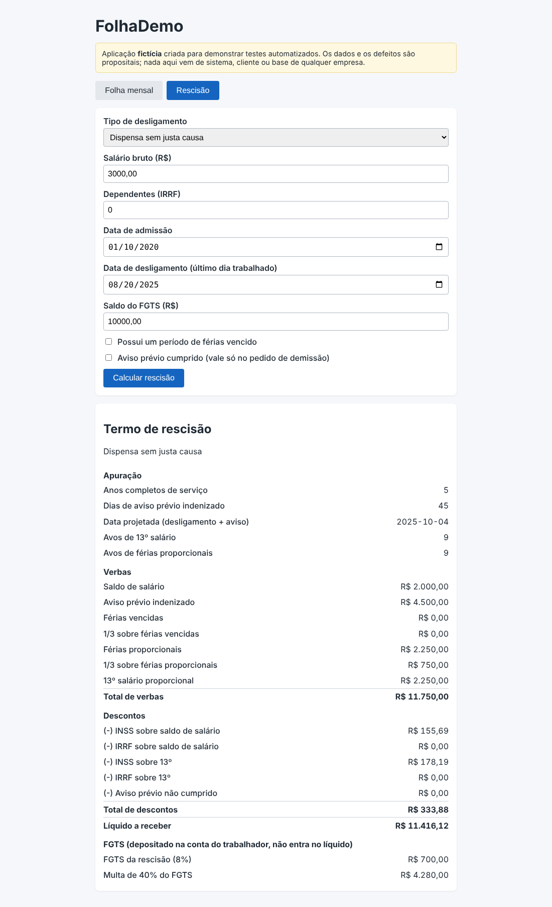
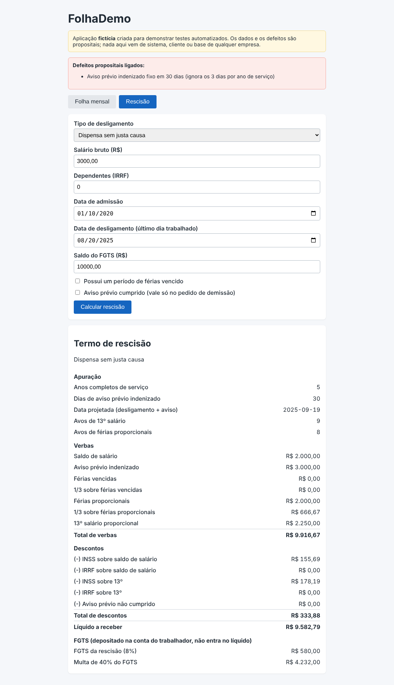

# DEF-10: Aviso prévio fixo em 30 dias, sem os 3 dias por ano de serviço

| Campo | Valor |
|---|---|
| Módulo | Rescisão |
| Regra de negócio | RN-RES-02 (`docs/regras-de-negocio.md`) |
| Identificador técnico | `res_aviso_sem_3_dias_por_ano` |
| Severidade | **Alta**: Aviso e verbas proporcionais pagos a menos para quem tem mais de 1 ano de casa. |
| Prioridade | **Alta**: Gera passivo trabalhista. |
| Origem | Defeito **plantado de propósito** para demonstração (sistema fictício) |
| Ambiente | FolhaDemo local (build de preview), Chrome, fuso America/Sao_Paulo |
| Status | **Fechado (simulado)**: detectado pela suíte; correção = desligar o defeito |

## Como ligar o defeito

Na URL: `/?defeitos=res_aviso_sem_3_dias_por_ano` ou, nos scripts, `DEFEITOS=res_aviso_sem_3_dias_por_ano`.

## Passos para reproduzir

1. Abrir a aplicação com o defeito ligado e ir para a aba **Rescisão**.
2. Preencher o formulário com os dados abaixo.
3. Clicar em **Calcular rescisão**.
4. Conferir os itens do termo de rescisão.

**Dados usados (todos fictícios)**

- Tipo: Dispensa sem justa causa
- Salário bruto: R$ 3.000,00
- Dependentes: 0
- Admissão: 10/01/2020
- Desligamento (último dia trabalhado): 20/08/2025
- Saldo do FGTS: R$ 10.000,00
- Férias vencidas: não
- Aviso prévio cumprido: não

## Resultado esperado x obtido

O esperado vem da calculadora independente (não da tela). A tabela mostra só os itens que divergem.

| Item | Esperado | Obtido com o defeito |
|---|---|---|
| Dias de aviso prévio | 45 | 30 |
| Data projetada | 04/10/2025 | 19/09/2025 |
| Avos de férias | 9 | 8 |
| Aviso prévio indenizado | R$ 4.500,00 | R$ 3.000,00 |
| Férias proporcionais | R$ 2.250,00 | R$ 2.000,00 |
| 1/3 férias proporcionais | R$ 750,00 | R$ 666,67 |
| Total de proventos | R$ 11.750,00 | R$ 9.916,67 |
| Líquido | R$ 11.416,12 | R$ 9.582,79 |
| FGTS rescisório | R$ 700,00 | R$ 580,00 |
| Multa de 40% do FGTS | R$ 4.280,00 | R$ 4.232,00 |

## Impacto

Aviso prévio pago a menos para quem tem mais de 1 ano de casa.

## Evidência

Sem o defeito (comportamento correto):

Com o defeito ligado:

## Como a suíte detecta

Executando a suíte com `DEFEITOS=res_aviso_sem_3_dias_por_ano`, ao menos um teste falha (ver `docs/qualidade/deteccao.md`). Sem o defeito, todos passam.

## Ciclo de vida

Novo → Em análise → Em correção → Corrigido → Reteste (com regressão em volta) → **Fechado**. Por ser defeito simulado, "corrigir" é desligá-lo; o reteste é a suíte completa passar sem ele.
