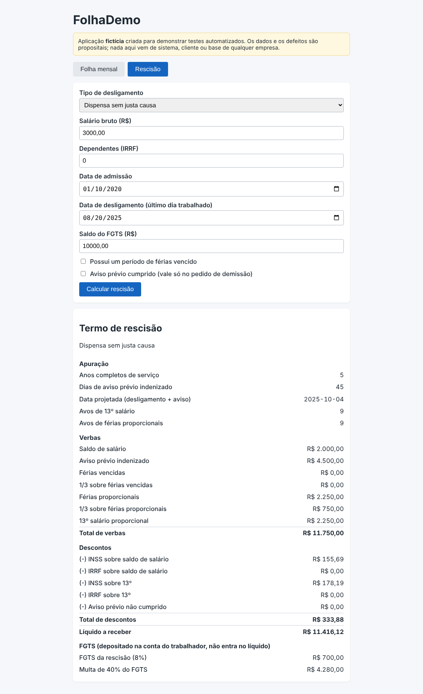
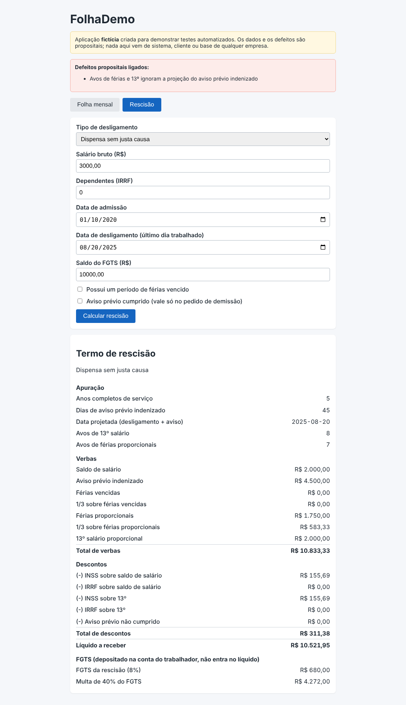

# DEF-11: Avos de férias e 13º ignoram a projeção do aviso prévio

| Campo | Valor |
|---|---|
| Módulo | Rescisão |
| Regra de negócio | RN-RES-03 (`docs/regras-de-negocio.md`) |
| Identificador técnico | `res_sem_projecao_aviso` |
| Severidade | **Alta**: Férias proporcionais e 13º pagos a menos. |
| Prioridade | **Alta**: Gera passivo trabalhista e não aparece como erro óbvio na tela. |
| Origem | Defeito **plantado de propósito** para demonstração (sistema fictício) |
| Ambiente | FolhaDemo local (build de preview), Chrome, fuso America/Sao_Paulo |
| Status | **Fechado (simulado)**: detectado pela suíte; correção = desligar o defeito |

## Como ligar o defeito

Na URL: `/?defeitos=res_sem_projecao_aviso` ou, nos scripts, `DEFEITOS=res_sem_projecao_aviso`.

## Passos para reproduzir

1. Abrir a aplicação com o defeito ligado e ir para a aba **Rescisão**.
2. Preencher o formulário com os dados abaixo.
3. Clicar em **Calcular rescisão**.
4. Conferir os itens do termo de rescisão.

**Dados usados (todos fictícios)**

- Tipo: Dispensa sem justa causa
- Salário bruto: R$ 3.000,00
- Dependentes: 0
- Admissão: 10/01/2020
- Desligamento (último dia trabalhado): 20/08/2025
- Saldo do FGTS: R$ 10.000,00
- Férias vencidas: não
- Aviso prévio cumprido: não

## Resultado esperado x obtido

O esperado vem da calculadora independente (não da tela). A tabela mostra só os itens que divergem.

| Item | Esperado | Obtido com o defeito |
|---|---|---|
| Data projetada | 04/10/2025 | 20/08/2025 |
| Avos de 13º | 9 | 8 |
| Avos de férias | 9 | 7 |
| Férias proporcionais | R$ 2.250,00 | R$ 1.750,00 |
| 1/3 férias proporcionais | R$ 750,00 | R$ 583,33 |
| 13º proporcional | R$ 2.250,00 | R$ 2.000,00 |
| INSS sobre o 13º | R$ 178,19 | R$ 155,69 |
| Total de proventos | R$ 11.750,00 | R$ 10.833,33 |
| Total de descontos | R$ 333,88 | R$ 311,38 |
| Líquido | R$ 11.416,12 | R$ 10.521,95 |
| FGTS rescisório | R$ 700,00 | R$ 680,00 |
| Multa de 40% do FGTS | R$ 4.280,00 | R$ 4.272,00 |

## Impacto

Férias proporcionais e 13º pagos a menos.

## Evidência

Sem o defeito (comportamento correto):

Com o defeito ligado:

## Como a suíte detecta

Executando a suíte com `DEFEITOS=res_sem_projecao_aviso`, ao menos um teste falha (ver `docs/qualidade/deteccao.md`). Sem o defeito, todos passam.

## Ciclo de vida

Novo → Em análise → Em correção → Corrigido → Reteste (com regressão em volta) → **Fechado**. Por ser defeito simulado, "corrigir" é desligá-lo; o reteste é a suíte completa passar sem ele.
