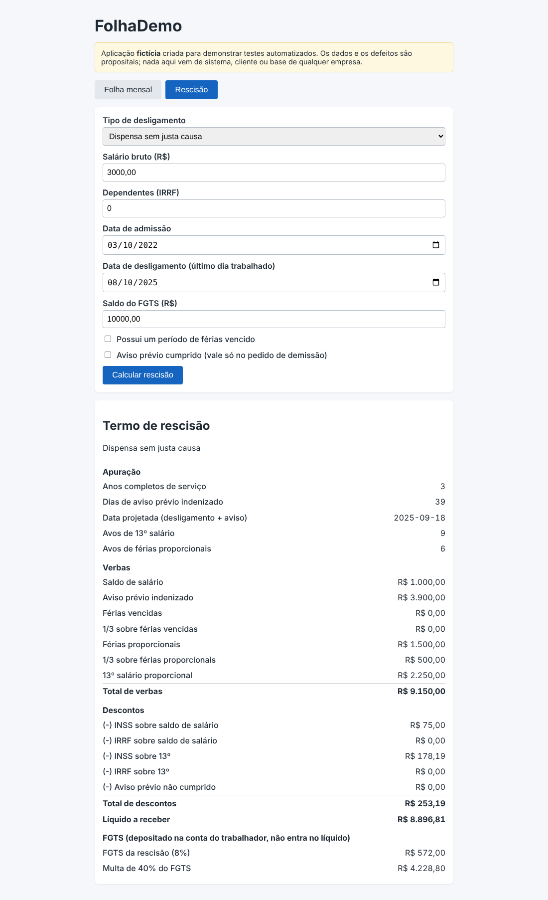
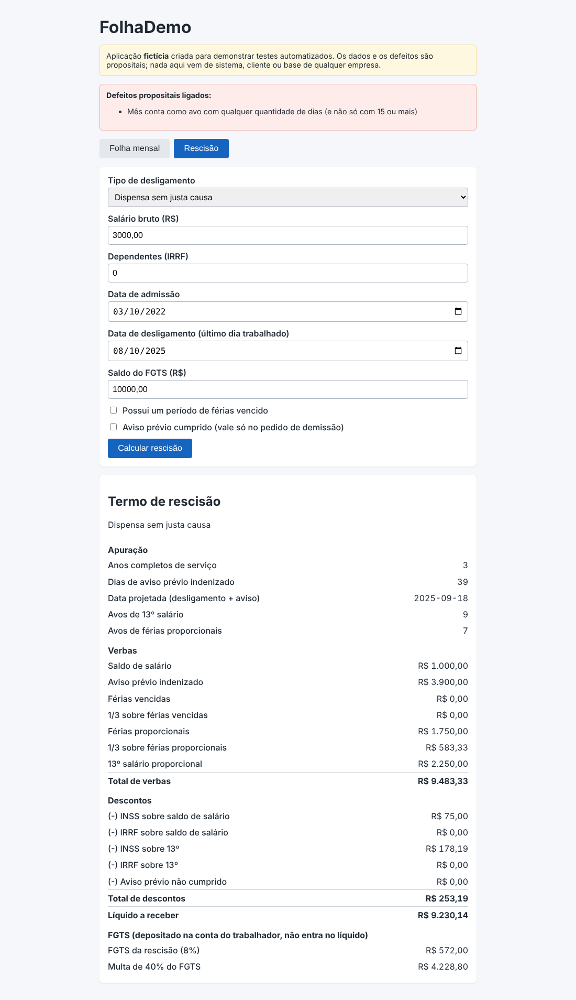

# DEF-13: Mês conta como avo mesmo com menos de 15 dias

| Campo | Valor |
|---|---|
| Módulo | Rescisão |
| Regra de negócio | RN-RES-04 (`docs/regras-de-negocio.md`) |
| Identificador técnico | `res_avos_qualquer_dia` |
| Severidade | **Média**: Férias proporcionais pagas a mais por 1 avo. |
| Prioridade | **Média**: Pagamento a maior; fica abaixo dos defeitos que lesam o trabalhador ou geram multa indevida. |
| Origem | Defeito **plantado de propósito** para demonstração (sistema fictício) |
| Ambiente | FolhaDemo local (build de preview), Chrome, fuso America/Sao_Paulo |
| Status | **Fechado (simulado)**: detectado pela suíte; correção = desligar o defeito |

## Como ligar o defeito

Na URL: `/?defeitos=res_avos_qualquer_dia` ou, nos scripts, `DEFEITOS=res_avos_qualquer_dia`.

## Passos para reproduzir

1. Abrir a aplicação com o defeito ligado e ir para a aba **Rescisão**.
2. Preencher o formulário com os dados abaixo.
3. Clicar em **Calcular rescisão**.
4. Conferir os itens do termo de rescisão.

**Dados usados (todos fictícios)**

- Tipo: Dispensa sem justa causa
- Salário bruto: R$ 3.000,00
- Dependentes: 0
- Admissão: 10/03/2022
- Desligamento (último dia trabalhado): 10/08/2025
- Saldo do FGTS: R$ 10.000,00
- Férias vencidas: não
- Aviso prévio cumprido: não

## Resultado esperado x obtido

O esperado vem da calculadora independente (não da tela). A tabela mostra só os itens que divergem.

| Item | Esperado | Obtido com o defeito |
|---|---|---|
| Avos de férias | 6 | 7 |
| Férias proporcionais | R$ 1.500,00 | R$ 1.750,00 |
| 1/3 férias proporcionais | R$ 500,00 | R$ 583,33 |
| Total de proventos | R$ 9.150,00 | R$ 9.483,33 |
| Líquido | R$ 8.896,81 | R$ 9.230,14 |

## Impacto

Férias proporcionais e 13º pagos a mais.

## Evidência

Sem o defeito (comportamento correto):

Com o defeito ligado:

## Como a suíte detecta

Executando a suíte com `DEFEITOS=res_avos_qualquer_dia`, ao menos um teste falha (ver `docs/qualidade/deteccao.md`). Sem o defeito, todos passam.

## Ciclo de vida

Novo → Em análise → Em correção → Corrigido → Reteste (com regressão em volta) → **Fechado**. Por ser defeito simulado, "corrigir" é desligá-lo; o reteste é a suíte completa passar sem ele.
